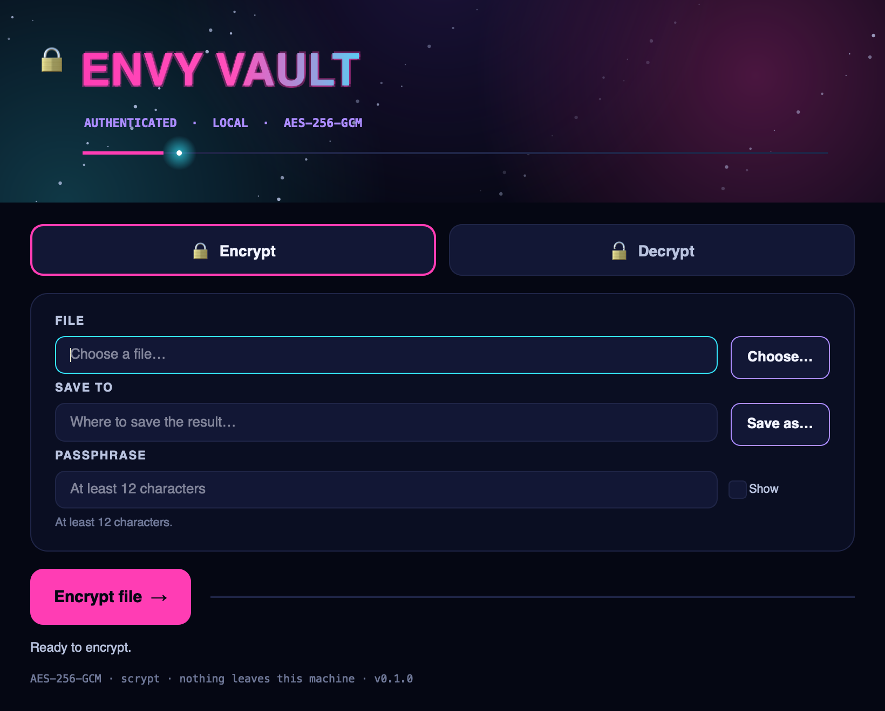

<p align="center">
  
</p>

<p align="center"><b>Encrypt a file so only your passphrase opens it — in a real native app window.</b><br />
AES-256-GCM with a scrypt-derived key, entirely on your own machine. From ENVY BLACK VEIL, as a standalone app.</p>

<p align="center">
  <a href="https://github.com/xzchick/envy-vault/actions/workflows/tests.yml"></a>
</p>
<p align="center">
  
  
  <br />
  
  
  
  
</p>

<p align="center">
  <a href="#install"><b>Install</b></a> ·
  <a href="#works-on">Compatibility</a> ·
  <a href="#using-vault">Using it</a> ·
  <a href="#how-it-protects-you">Security</a> ·
  <a href="#build--test">Build</a>
</p>

<p align="center">
  
</p>

<p align="center"><sub>A real native window — not a browser view. The title pulses, the stars twinkle, a light travels the accent bar, and a pink-to-cyan shimmer runs while it works.</sub></p>

<a name="features"></a>




ENVY Vault locks a file with a passphrase and nothing else — no key files, no accounts, no cloud, no recovery backdoor. The passphrase is stretched with **scrypt** and the file is sealed with **AES-256-GCM**, so a wrong passphrase or any change to the encrypted file is rejected. It writes a **new** file every time and never touches your original. Files it writes are byte-compatible with the Vault inside ENVY BLACK VEIL.

<a name="works-on"></a>


<p align="center">
  
  
  
</p>



<details>
<summary><b>Compatibility table as text</b></summary>

| Feature | macOS | Windows | Linux |
|---|:---:|:---:|:---:|
| Native application window | ✅ | ✅ | ✅ |
| Encrypt and decrypt files | ✅ | ✅ | ✅ |
| AES-256-GCM with a scrypt key | ✅ | ✅ | ✅ |
| Terminal mode (CLI) | ✅ | ✅ | ✅ |
| Files interoperable with ENVY Vault | ✅ | ✅ | ✅ |
| Never overwrites your originals | ✅ | ✅ | ✅ |
| Standalone bundle (no Python) | arm64 | x86_64 | x86_64 |
| Python package (`pip install`) | ✅ | ✅ | ✅ |
| Nothing leaves the machine | ✅ | ✅ | ✅ |
| Built and tested in CI | ✅ | ✅ | ✅ |

</details>

### Requirements

| | 🍎 macOS | 🪟 Windows | 🐧 Linux |
|---|---|---|---|
| **OS version** | macOS 11 Big Sur or newer | Windows 10 or 11 (64-bit) | A current x86_64 or arm64 desktop |
| **Standalone bundle** | Nothing else to install | Nothing else to install | Standard desktop libraries (X11 or Wayland) |
| **From pip** | Python 3.10+ | Python 3.10+ | Python 3.10+ and a desktop session |
| **Disk** | ~90 MB installed | ~90 MB installed | ~90 MB installed |
| **Network** | None, ever | None, ever | None, ever |

> [!NOTE]
> The standalone bundle carries its own Python, Qt and the `cryptography` library, so a clean machine needs nothing else. The `pip` route reuses a Python you already have.

<a name="install"></a>


Two ways on every system: a **standalone bundle** that needs no Python, or **pip** if you already have Python 3.10+.

### Standalone bundle (no Python) — coming with v0.1.0

The v0.1.0 release will attach a bundle per system. When published, download it from **Releases**:

| File | System | Run it |
|---|---|---|
| `envy-vault-v0.1.0-macos-arm64.tar.gz` | macOS (Apple Silicon) | `tar -xzf` it, then open `envy-vault` |
| `envy-vault-v0.1.0-windows-x86_64.zip` | Windows (64-bit) | Unzip, then run `envy-vault.exe` |
| `envy-vault-v0.1.0-linux-x86_64.tar.gz` | Linux (64-bit) | `tar -xzf` it, then run `./envy-vault` |
| `envy_vault-0.1.0-py3-none-any.whl` | Any OS with Python 3.10+ | `pip install envy_vault-0.1.0-py3-none-any.whl` |
| `SHA256SUMS.txt` | — | Verify your download first |

Running `envy-vault` with no arguments opens the window. Double-clicking works too.

### From pip (Python 3.10+)

```sh
git clone https://github.com/xzchick/envy-vault.git
cd envy-vault
python3 -m venv .venv
. .venv/bin/activate        # Windows: .venv\Scripts\activate
pip install .
envy-vault                  # opens the window
```

<details>
<summary><b>Linux desktop libraries</b></summary>

The window uses Qt. On a minimal install you may need the usual desktop libraries, for example on Debian/Ubuntu:

```sh
sudo apt install -y libxcb-cursor0 libxcb-xinerama0
```

Most desktop Linux installs already have these.

</details>

<a name="using-vault"></a>


**In the window**

1. Pick **Encrypt** or **Decrypt**.
2. Choose the file, and where to save the result.
3. Type your passphrase (at least 12 characters) and press **Encrypt file →**.

The result is a new file; your original stays put. Encrypting suggests a `.envy` name; decrypting removes it.

**In the terminal**

```sh
envy-vault encrypt report.pdf report.pdf.envy
envy-vault decrypt report.pdf.envy report.pdf
```

It asks for the passphrase at a hidden prompt and never writes over an existing file.

> [!IMPORTANT]
> There is no backdoor and no recovery. If you lose the passphrase, the file cannot be opened — by you or anyone else. Keep a safe copy of important passphrases.

<a name="how-it-protects-you"></a>


- **Cipher:** AES-256 in GCM mode — it both encrypts and authenticates, so tampering is detected.
- **Key:** derived from your passphrase with **scrypt** (`n=2^15, r=8, p=1`), with a random 16-byte salt per file, which makes guessing passphrases expensive.
- **Envelope:** `MAGIC(11) · salt(16) · nonce(12) · ciphertext+tag`. The header is bound in as authenticated data, so a truncated or edited file fails to decrypt.
- **Safety:** a fresh random nonce per file, output written only to a new file (never overwriting), and nothing sent anywhere.

This protects data **at rest**. It is not a secure-delete tool and does not hide that a file is encrypted. The strength rests on your passphrase: longer and more random is stronger.

<a name="build--test"></a>


```sh
python -m unittest discover -s tests -v          # unit tests (no display needed)
pip install pyinstaller build
python scripts/build_release_bundle.py           # standalone bundle + wheel + sdist + checksums
python scripts/smoke_test_release.py             # launch the built bundle and check it runs
```

CI runs all of this on Ubuntu, Windows and macOS for every push. The tests include a **golden vector** produced by the original ENVY Vault, so byte-compatibility is checked automatically. To regenerate the README artwork: `python scripts/render_readme_art.py`.

<a name="more"></a>

<p align="center"><sub>MIT licensed. Part of ENVY BLACK VEIL, packaged as a standalone app. Local and offline; no telemetry, no network, no accounts.</sub></p>
